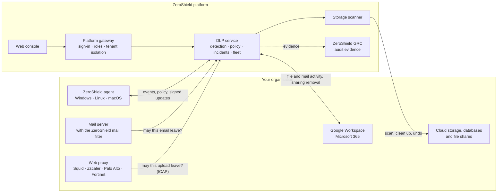
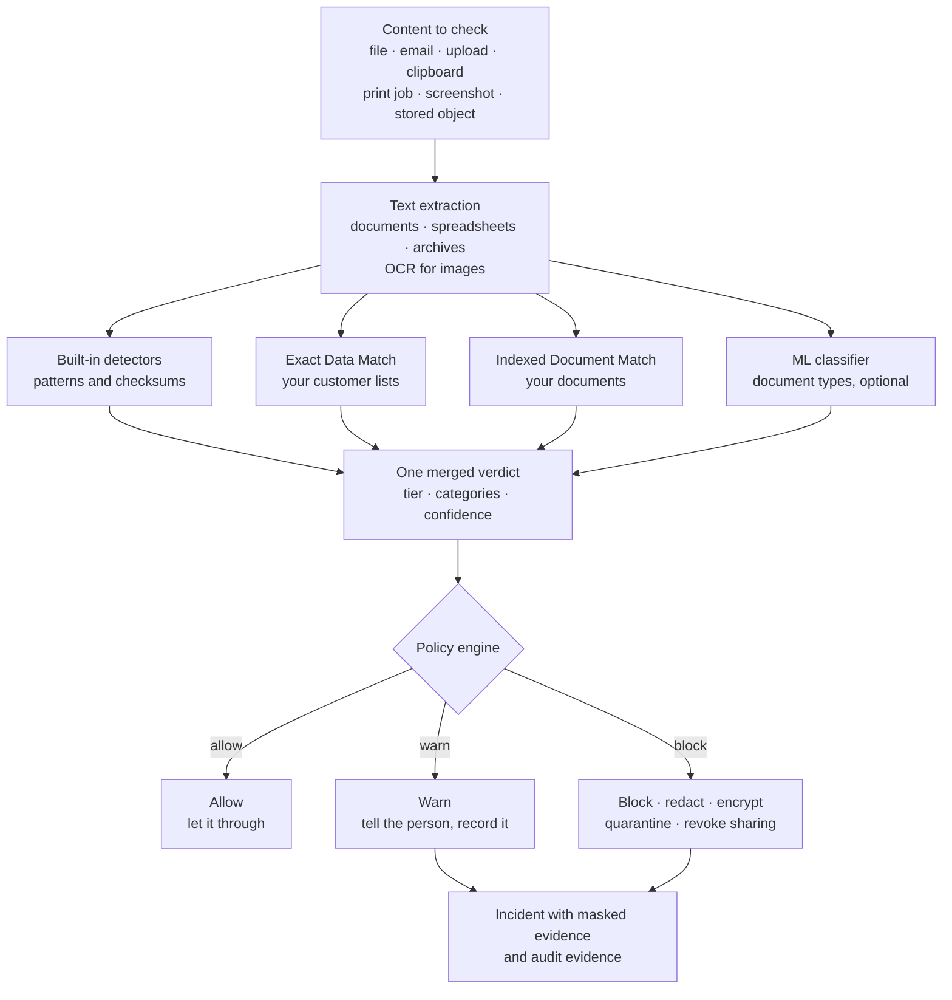
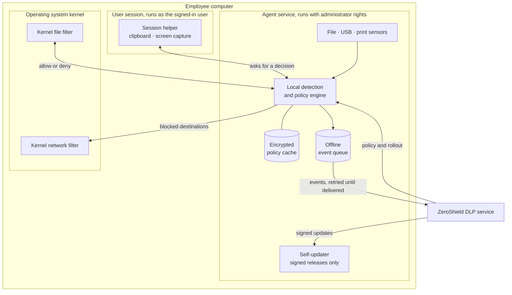
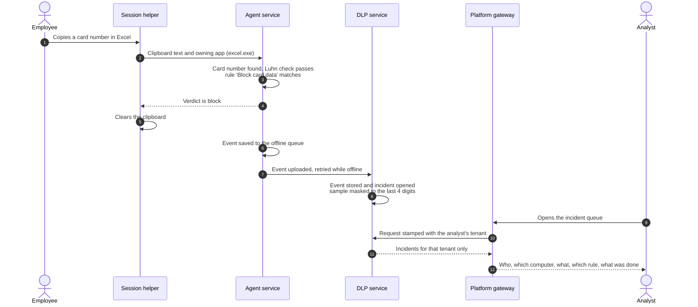
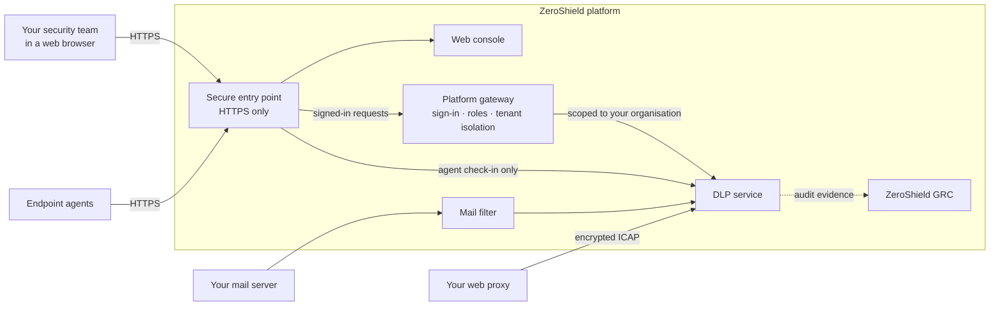
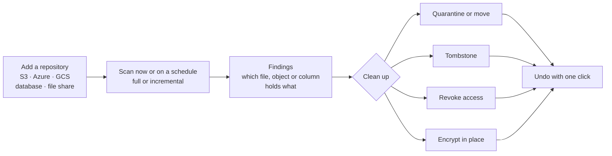
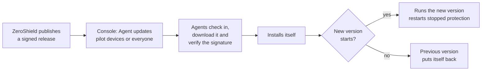
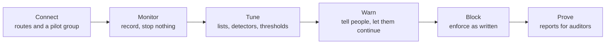

# 🛡️ _ZeroShield DLP - Data Loss Prevention_

### _Find Sensitive Data, Stop It Leaving and Prove It to Your Auditors, Across Laptops, Email, Cloud Apps and Storage_

_ZeroShield DLP, a core module of <a href="https://zeroshield.ai">ZeroShield</a>_

## 🚀 [Explore ZeroShield Solutions](https://zeroshield.ai)

## Table of Contents
* [About ZeroShield DLP](#about-zeroshield-dlp)
  * [Key Highlights](#key-highlights)
* [System Architecture](#system-architecture)
  * [Architecture diagrams](#architecture-diagrams)
* [Core Modules](#core-modules)
  * [1. Detection Engine](#1-detection-engine)
  * [2. Policies & Enforcement](#2-policies--enforcement)
  * [3. Endpoint DLP](#3-endpoint-dlp)
  * [4. Data in Motion](#4-data-in-motion)
  * [5. Data at Rest](#5-data-at-rest)
  * [6. Incident Management & Investigation](#6-incident-management--investigation)
  * [7. Connections](#7-connections)
  * [8. Dashboards, Reports & Compliance Evidence](#8-dashboards-reports--compliance-evidence)
* [Endpoint Agent & Deployment](#endpoint-agent--deployment)
  * [Platform Support](#platform-support)
  * [Installation & Enrolment](#installation--enrolment)
  * [Automatic, Signed Updates](#automatic-signed-updates)
  * [Self-Protection & Resilience](#self-protection--resilience)
* [Security & Data Protection](#security--data-protection)
* [Organisations & Roles](#organisations--roles)
* [Measured Performance](#measured-performance)
* [Governance & Compliance](#governance--compliance)
* [Recommended Rollout](#recommended-rollout)
* [Target Users & Example Scenarios](#target-users--example-scenarios)
* [Use Cases](#use-cases)
* [Frequently Asked Questions](#frequently-asked-questions)
* [Complete Product Video](#complete-product-video)
* [Support](#support)

---

## About ZeroShield DLP

[**ZeroShield DLP**](https://zeroshield.ai) is the data loss prevention module of the ZeroShield platform. It finds sensitive data (Aadhaar and PAN numbers, payment cards, bank details, passwords and API keys, your customer lists and your confidential documents), decides whether to **allow**, **warn** or **block**, carries out the action your policy calls for, and records an incident with masked evidence.

It covers the three places data lives with **one detection engine, one set of policies and one console**:

| | Where | What is checked |
| :--- | :--- | :--- |
| 💻 **Endpoints** | Employees' laptops and desktops | Files saved and copied, clipboard, USB drives, printing, screenshots, network uploads |
| 📤 **Data in motion** | Data being sent | Outgoing email, Google Drive and OneDrive sharing, uploads through your web proxy, FTP and SFTP |
| 🗄️ **Data at rest** | Data being stored | Amazon S3, Azure Blob Storage, Google Cloud Storage, PostgreSQL, MySQL, SQL Server, Oracle, Windows and NFS file shares |

ZeroShield DLP is built for organisations that answer to India's **Digital Personal Data Protection (DPDP) Act 2023** and RBI guidelines, as well as **PCI DSS**, **GDPR**, **HIPAA**, **ISO 27001** and **SOC 2**. Indian identifiers are first-class: Aadhaar numbers are validated with the Verhoeff checksum, GSTINs with their check character and PANs with their structure rules, alongside IFSC codes, UPI IDs and Indian passport and mobile numbers.

### Key Highlights

* 🔍 **One engine for every channel**: the same detectors, customer lists and policies apply on laptops, in email, in cloud apps, on the network and in storage.
* ✅ **Checksum-validated detection**: card numbers must pass the Luhn check and Aadhaar numbers the Verhoeff check, so invoice numbers and random digit runs do not raise alarms.
* 🧬 **Your own data, never stored in clear**: upload customer lists (Exact Data Match) and confidential documents (Indexed Document Match). ZeroShield keeps only salted fingerprints.
* 💻 **Native endpoint agent** for Windows, Linux and macOS (preview), covering files, clipboard, USB, print, screen capture and network.
* ☁️ **No passwords shared for cloud**: Google Workspace and Microsoft 365 connect through admin consent, and Amazon S3 through a read-only role in your own AWS account.
* 🧹 **Reversible clean-up**: quarantine, tombstone, revoke public access or encrypt stored files, each with one-click undo.
* 🔒 **Privacy by design**: matched values are masked at the moment of capture. The real card or Aadhaar number is never stored.
* 📊 **Audit-ready reporting**: compliance reports for the DPDP Act 2023, PCI DSS v4.0, GDPR and the HIPAA Security Rule, plus control evidence sent to ZeroShield GRC.
* 🏢 **Multi-tenant**: each organisation's users, agents, rules, incidents and data are kept apart by the server, not by the browser.

> 📸 **[Screenshot: dlp-overview.png]** DLP Overview: open incidents, agents online, sensitive findings, the 30-day incident trend and activity per channel.

---

## System Architecture

ZeroShield DLP follows a **Connect → Detect → Enforce → Prove** lifecycle:

1. **Connect**: install the agent on computers, connect email and cloud apps, register storage and write policies, all from the console.
2. **Detect**: every file, message, upload, clipboard copy, print job and stored object is checked by the same detection engine.
3. **Enforce**: the policy engine picks the action, and the point of enforcement carries it out: the agent on the computer, the mail filter, your web proxy, the cloud-app connector or the storage scanner.
4. **Prove**: each decision is recorded as an incident with masked evidence, reported per channel and per law, and sent to ZeroShield GRC as audit evidence.

### Architecture diagrams

**High-level: where data is checked and how the platform fits together**

**Detection pipeline: from content to decision**

**Endpoint agent: how it protects a computer**

The agent has two parts. The **agent service** runs with administrator rights and holds the policy, the detection engine and the offline event queue. The clipboard and the screen belong to the signed-in person, so a small **session helper** runs inside each user session and asks the service for a decision. The helper never decides anything itself, which keeps the part running with the employee's own rights as simple as possible.

**One event, end to end: a card number copied on a Windows laptop**

**Security boundaries: one way in**

* 🚪 The DLP service's management functions are never exposed to the internet. People reach them only by signing in to the console, and the browser never holds a key to the DLP service.
* 🏷️ The browser never chooses which organisation's data it sees. The platform gateway takes the organisation from the signed-in session and applies it to every request; a request naming another organisation is refused and logged.
* 🤖 Agents can reach only their own check-in, enrolment and installer-download functions, and each checks its own credential.

---

## Core Modules

Everything is managed from the **Data Protection** section of the ZeroShield console:

| Screen | What it is for |
| :--- | :--- |
| **DLP Overview** | Open incidents, agents online, sensitive findings, scans, the 30-day trend and channel activity |
| **Connections** | One card per route data can take, whether it is protected, and how to set it up |
| **Incidents** | Every detection that opened an incident, with filters, triage and history |
| **Policies** | The enforcement mode, computer settings and the rules in force |
| **Data at Rest** | Repositories, scans, findings, clean-up history and schedules |
| **Data in Motion** | Activity per channel and every email decision |
| **Endpoints** | The enrolled fleet, channel health, endpoint events, installers and agent updates |
| **Detection & Tuning** | Your customer lists and documents, the rules in force and what has matched |
| **DLP Reports** | Channel coverage, detector health and compliance reports |

### 1. Detection Engine

Every channel hands content to the same engine. The detectors run together and their results are merged into **one verdict**: a sensitivity tier (Regulated, Confidential, Internal or Public), the categories found, a confidence score and a masked sample.

**Built-in detectors**

| Category | What it finds | How false alarms are kept down | Default tier |
| :--- | :--- | :--- | :--- |
| 💳 **Payment cards** | 13–16 digit card numbers, with or without spaces and dashes | Luhn checksum | Regulated |
| 🆔 **Aadhaar** | 12-digit Aadhaar numbers | Verhoeff checksum | Regulated |
| 🧾 **PAN** | Permanent Account Numbers | Structure rules, including the holder-type letter | Regulated |
| 🏢 **GSTIN** | GST identification numbers | Format and check character | Regulated |
| 🛂 **Indian passport** | Passport numbers | Format, and only near the word "passport" | Regulated |
| 🔑 **Secrets and API keys** | AWS access keys, PEM and PGP private keys, GitHub, Slack, Google, Stripe, OpenAI and Anthropic keys, JSON Web Tokens | Each issuer's fixed prefix and format | Regulated |
| 📱 **Indian mobile numbers** | 10-digit numbers starting 6–9, with an optional +91 or 0 | Format and word boundaries | Internal |
| 🏦 **IFSC codes** | Bank branch codes | Format | Internal |
| 💸 **UPI IDs** | IDs on known payment-app and bank handles | Known handles only, so ordinary email addresses do not match | Internal |
| 📧 **Email addresses** | Any email address | Format | Internal |
| 🏷️ **Confidentiality markings** | CONFIDENTIAL, RESTRICTED, TOP SECRET, SALARY, FINANCIAL REPORT and similar | Keyword list | Internal |

Regulated categories block by default and Internal categories warn by default. Your policies decide the final action for every category on every channel. Context words such as *card*, *account*, *PAN* or *Aadhaar* near a match raise its confidence.

**Your own data**

* 🧬 **Exact Data Match (EDM)**: upload a customer or employee list as CSV or TSV. ZeroShield stores salted, keyed hashes of the values, never the values, and then catches *those exact* records (this customer's PAN, that account number) rather than anything shaped like one. Rotating the salt does not break existing lists.
* 📑 **Indexed Document Match (IDM)**: upload contracts, designs, price lists or board papers as text, Word, PDF or Excel files. ZeroShield fingerprints them, and an excerpt of about 35 words or more found elsewhere counts as a match, even when only part of the document was copied.
* 🧩 **Custom detectors**: add your own patterns, for example an employee ID such as EMP-123456, optionally narrowed by nearby words, and test them against sample text in the console before saving.
* 🔤 **Keywords**: project code names and internal markings, for example "Project Phoenix".

Customer lists and indexed documents are matched in email, cloud apps, network uploads and stored data. On laptops, the agent applies the built-in detectors, custom detectors and keywords locally.

**Beyond plain text**

* 📄 Text is extracted from spreadsheets and archives (zip, tar and gzip, nested up to two levels deep), and from PDF and Office documents when the document-extraction service is enabled.
* 🖼️ **OCR** reads text in images and screenshots. On Windows computers the agent uses the OCR engine built into Windows, so there is nothing extra to install.
* 🤖 An optional **ML classifier** recognises document types that have no fixed pattern, such as NDAs, invoices and résumés.

> 📸 **[Screenshot: dlp-detection-tuning.png]** Detection & Tuning: customer lists and documents, the rules in force, and what has matched by tier, channel and action.

### 2. Policies & Enforcement

A policy is the organisation's rulebook: what to look for, where, and what to do when it is found.

**Enforcement mode** is one switch over every rule:

| Mode | What happens | When to use it |
| :--- | :--- | :--- |
| 👀 **Monitor** | Everything is recorded and nothing is stopped | The first week, to see what really happens without disturbing anyone |
| ⚠️ **Warn** | People are warned and allowed to continue; the event is recorded | To build awareness before enforcing |
| ⛔ **Block** | Rules are enforced exactly as written | Full enforcement |

**What a rule contains**

| Field | Meaning |
| :--- | :--- |
| **Name** | For example "Block Aadhaar numbers" |
| **Categories** | Built-in categories, your customer lists (EDM) and your documents (IDM) |
| **Channels** | Where the rule applies: laptops, email, cloud apps, network or stored data |
| **Minimum confidence** | How sure the engine must be before acting; checksum-valid numbers score high |
| **Priority** | When several rules match, the most severe action wins, and priority decides between rules with the same action |
| **Blocked destinations** | Sites or addresses laptops cannot connect to, for example wetransfer.com |
| **Keywords and custom patterns** | Your own markers and formats, with a live test box |
| **Open an incident** | Record matches for the security team |
| **Notify the user** | Show a Windows notification when a copy is warned about, blocked or masked |
| **Let the user continue with a reason** | On Windows, a blocked file save, USB copy or clipboard copy asks the person why. With a reason, the file or copy is restored and the reason appears on the incident for review |

**Actions**

| Action | What it does |
| :--- | :--- |
| ✅ **Allow** | Let it through, for example for a team permitted to handle this data |
| ⚠️ **Warn** | Let it through, tell the person and record it |
| ⛔ **Block** | Stop it. On a laptop the clipboard is cleared, a file or USB copy is moved to quarantine, the print job is cancelled and the connection is refused |
| ✂️ **Redact** | Mask the sensitive part and let the rest through: in email, and in text copied on Windows |
| 🔐 **Encrypt** | Encrypt the sensitive parts of an email, or a stored file in place |
| 📦 **Quarantine / Move** | Move an email or a stored file into quarantine |
| 📝 **Tombstone** | Quarantine a stored file and leave a note in its place saying where it went |
| 🚫 **Revoke** | Remove public or shared access to a stored file so only the owner keeps it |

**Computer settings** decide what laptops watch: which channels are on, up to eight folders to watch (for example Documents, Desktop and Downloads), how often the screen is sampled (from every 30 seconds to every hour), and whether USB storage is open to all drives or limited to **approved drives**, identified by serial number. Laptops pick up a change within about a minute.

> 📸 **[Screenshot: dlp-policies.png]** Policies: enforcement mode, computer settings and the saved rules.
>
> 📸 **[Screenshot: dlp-rule-editor.png]** Rule editor: categories, channels, confidence, blocked destinations and a live custom-detector test.

### 3. Endpoint DLP

The ZeroShield agent is a lightweight program that runs on each employee's computer. It downloads the organisation's policy, checks activity against it **on the device**, enforces what the policy says and reports back. Because decisions are made locally, protection continues while a laptop is offline.

| Channel | What the agent does | Example |
| :--- | :--- | :--- |
| 📁 **Files** | Checks files created, written, copied or renamed in watched folders. With the kernel file filter the write is refused before it completes; without it, a blocked file is moved to quarantine | A spreadsheet of card numbers saved to Documents is blocked |
| 📋 **Clipboard** | Checks each copy and the application that made it, then clears the clipboard, or on Windows masks just the sensitive part | An Aadhaar number copied from a customer record is cleared from the clipboard |
| 💾 **Removable media** | Checks files written to USB drives and quarantines blocked files on the drive; optional approved-drives-only device control | A payroll export copied to a personal stick is quarantined on the stick |
| 🖨️ **Print** | Reads the content of each print job and cancels the job at the spooler when blocked | Printing a customer list with PAN numbers is cancelled |
| 🖥️ **Screen capture** | Samples the screen and reads it with on-device OCR. Detection only, because no operating system lets an application refuse a screenshot | Card numbers on screen when it is sampled are recorded |
| 🌐 **Network** | Refuses connections to blocked destinations inside the kernel, whichever browser or tool is used | Uploads to wetransfer.com fail in every browser |

> 🎬 **[Video: dlp-endpoint-demo.mp4]** Clipboard, file, USB and network blocks on a laptop, each appearing in the incident queue.
>
> 📸 **[Screenshot: dlp-endpoints.png]** Endpoints: every enrolled computer with its user, operating system, agent version, last check-in and a health dot per protection channel.

What each operating system supports today, including where kernel-level blocking is available, is listed under [Platform Support](#platform-support).

### 4. Data in Motion

Data being sent is checked against the same policies on whichever route it takes.

**📧 Email**

| Route | How it connects | What it can do |
| :--- | :--- | :--- |
| **Before it leaves** | The ZeroShield mail filter, added to your own mail server (for example Postfix) | Deliver, deliver with a warning header, redact or encrypt the sensitive parts, or reject or hold the message |
| **Gmail and Outlook** | The Google Workspace or Microsoft 365 connection | Checks every sent message within minutes, including mail sent from phones. The message has already been delivered, so the decision is recorded and an incident opened |

Attachments are opened and checked, including archives. A zip or PDF attachment that would still carry card numbers after redaction is rejected rather than delivered. The Data in Motion screen lists every message ZeroShield ruled on, not only the blocked ones, and shows a recipient count rather than recipient addresses.

**☁️ Cloud apps**

* **Google Drive** (through Google Workspace) and **OneDrive** (through Microsoft 365) are connected by your administrator approving ZeroShield in your own admin console. No password is shared, and withdrawing the approval cuts access immediately.
* Every few minutes ZeroShield reads file activity (uploads, new files, edits and sharing changes) and checks each file touched with the same detectors, customer lists and policies.
* When the policy blocks and the file is shared outside the organisation (a public link, another domain or an outside person), **that outside sharing is removed**. The owner keeps the file and nothing is deleted.
* Events from an existing cloud access security broker (CASB) can also be forwarded. Sanctioned apps get content checks; uploads to unsanctioned apps are blocked even when the file is clean.

**🌐 Company network**

* Your web proxy (Squid, Zscaler, Palo Alto, Fortinet and others) asks ZeroShield over **ICAP** before letting an upload leave. A blocked upload shows the person a ZeroShield page instead.
* Each organisation gets its own encrypted ICAP address, with the certificate downloadable from the console.
* An HTTPS inspection policy lists which hosts must be inspected and which must bypass interception (for example apps that pin their certificates). Your proxy performs the interception, and an in-scope HTTPS connection that was not inspected is refused rather than waved through.
* FTP and SFTP uploads passed on by a file-transfer gateway are allowed or refused in the same way.

> 🎬 **[Video: dlp-email-cloud-demo.mp4]** A Gmail message carrying a PAN is recorded with a masked sample, and a Google Drive file with Aadhaar numbers loses its public link within minutes.
>
> 📸 **[Screenshot: dlp-data-in-motion.png]** Data in Motion: activity per channel and every email decision with its outcome.

### 5. Data at Rest

Sensitive data sitting in storage is often the largest hidden risk. ZeroShield finds it, shows exactly where it is and cleans it up, reversibly.

| Repository | Examples | How ZeroShield gets access |
| :--- | :--- | :--- |
| ☁️ **Amazon S3** | Buckets and prefixes | A **read-only IAM role in your own AWS account**, trusted only with an external ID unique to your organisation. No keys are shared, and the console shows the exact policies to create |
| ☁️ **Azure Blob Storage and ADLS Gen2** | Containers and prefixes | An account key or SAS token, stored encrypted |
| ☁️ **Google Cloud Storage** | Buckets and prefixes | A service-account key, stored encrypted |
| 🗃️ **Databases** | PostgreSQL, MySQL, SQL Server, Oracle | A database login, stored encrypted. Columns are **sampled** and no rows are stored |
| 🗂️ **File shares and folders** | Windows (SMB) shares, NFS exports, local folders on Windows, Linux and macOS | A share login, stored encrypted, or none for local folders |

**How it works**

1. **Add a repository** from the console.
2. **Scan** now or on a schedule, in full or incrementally. Repeat scans skip anything that has not changed, and scanning can be rate-limited to protect production systems.
3. **Review findings**: which file, object or column holds what (for example *customers.csv: card numbers and PAN*), each with a masked sample.
4. **Clean up** with one click, or turn on *clean up automatically after each scan*.

| Clean-up | Effect | Undo |
| :--- | :--- | :--- |
| 📦 **Quarantine / Move** | The file moves into a locked quarantine location | Moves it back |
| 📝 **Tombstone** | Quarantine, plus a short note in its place saying why it is gone | Puts the file back |
| 🚫 **Revoke** | Public and shared access is removed; only the owner keeps it | Restores the previous access |
| 🔐 **Encrypt** | The content is replaced by its encrypted form (AES-256) | Decrypts it in place |

Clean-up runs on Amazon S3, local folders and NFS exports. On other repositories, findings are reported for the data owner to act on. Archived objects (S3 Glacier, Azure Archive tier) and objects encrypted with keys ZeroShield does not hold are reported as skipped, never silently restored or guessed at.

> 🎬 **[Video: dlp-data-at-rest-demo.mp4]** An S3 bucket is scanned, a file with card numbers is quarantined, and the quarantine is undone.
>
> 📸 **[Screenshot: dlp-data-at-rest.png]** Data at Rest: repositories, scans, findings with masked samples, and the clean-up history with Undo.

### 6. Incident Management & Investigation

Each rule match the policy records becomes an incident that answers an investigator's first questions:

* 👤 **Who**: the user or email sender, with a stable pseudonymous reference for linking incidents across channels.
* 💻 **Where**: the computer, the Drive or OneDrive file, or the storage location.
* 🔎 **What**: the tier, the categories and a **masked sample**: `**** **** **** 1111` for a card, `ABCPS****F` for a PAN, `**** **** 9012` for an Aadhaar number. The real value is never stored.
* 📜 **Which rule** matched and **what was done**.
* 🧭 **Channel and source**: *what the data did* (clipboard, USB, print, screen, file, network, email, web or at rest) and *what observed it* (the endpoint agent, the mail filter, your web proxy, a cloud-app connection or the storage scanner).

**Workflow**: Open → Investigating or Escalated → Resolved, with optional notes and a timeline of who changed what.

**Less noise**: repeated events are grouped. Fifty blocked connections from one computer to one site within an hour become one incident with an attempt count.

> 📸 **[Screenshot: dlp-incident-detail.png]** Incident detail: the detection, masked evidence, workflow and timeline.

### 7. Connections

The Connections screen answers "what is protected?" with one card per route. Each card shows its state (**Connected**, **Available** or **Off**), whether it can block, and the setup steps:

| Route | What it covers | Setup |
| :--- | :--- | :--- |
| 💻 **Laptops and desktops** | Copy and paste, USB drives, printing, files, screenshots and network uploads | Download the installer from Endpoints and run it on each computer |
| 🗄️ **Stored data** | Cloud buckets, file shares and databases, on demand or on a schedule | Add a repository; for Amazon S3, create the read-only role the form describes |
| 📧 **Email** | Outgoing email before it leaves, or every sent message soon after | Route outgoing mail through the ZeroShield mail filter, or connect Google Workspace or Microsoft 365 |
| ☁️ **Cloud apps** | Files uploaded to and shared from Google Drive or OneDrive | Your administrator approves ZeroShield; no password is shared |
| 🌐 **Company network** | Uploads leaving through your web proxy | Add ZeroShield as an ICAP service in your web proxy |

> 📸 **[Screenshot: dlp-connections.png]** Connections: one card per route, with its live state and setup steps.

### 8. Dashboards, Reports & Compliance Evidence

**DLP Overview** is the security team's home page: open incidents, agents online (and how many report tampering), sensitive findings, scans, the 30-day incident trend with its blocked share, and activity per channel.

**DLP Reports** is written for management and auditors:

* 📈 **Channel coverage**: for each channel, how many events it checked, how many it blocked, and its health, downloadable for your records.
* 🩺 **Detector health**: how many detectors are loaded, enabled and actually able to match. A detector that is switched on but cannot match (for example a customer-list matcher with no list loaded) is named, with the reason.
* 📚 **Compliance reports** for the **DPDP Act 2023**, **PCI DSS v4.0**, **GDPR** and the **HIPAA Security Rule**. Each shows the data the law protects, how far your policy covers it (including categories with no rule, or only a recording rule), the incidents, and the **data that got through**, which helps decide whether a breach must be reported (for example under GDPR's 72-hour rule). Reports contain no sample of the data, masked or not, and can be printed to PDF.
* 🧾 **Evidence for ZeroShield GRC**: blocked transfers, classification and personal-data protection events are sent as audit evidence, mapped to ISO 27001:2022, SOC 2, PCI DSS 4.0, HIPAA, GDPR and DPDP controls. If GRC is unreachable, evidence waits in a durable queue and detection carries on.

**Blank is not zero.** A blank means the feature is switched off, so nothing was measured; a zero means it was measured and nothing was found. A dashboard showing a confident zero for a channel nobody enabled would mislead the people relying on it.

> 📸 **[Screenshot: dlp-reports.png]** DLP Reports: channel coverage, detector health and a DPDP Act 2023 compliance report.

---

## Endpoint Agent & Deployment

### Platform Support

| | **Windows** | **Linux** | **macOS** (preview) |
| :--- | :--- | :--- | :--- |
| **Versions** | 64-bit; tested on Windows 11 and Windows Server 2022 | 64-bit: Debian 12+, Ubuntu 22.04+, RHEL, Rocky and AlmaLinux 9+, Amazon Linux 2023 | macOS 14 Sonoma or later |
| **Package** | MSI | .deb and .rpm | .pkg |
| **Files** | ✅ quarantine in watched folders · ⏳ refused in the kernel (driver build)¹ | ✅ refused in the kernel | ⏳ awaiting Apple approval² |
| **Clipboard** | ✅ clear or mask | ✅ X11 and Wayland desktops | 🧪 |
| **Removable media** | ✅ | ✅ | 🧪 |
| **Print** | ✅ | ✅ | 🧪 |
| **Screen capture** | ✅ uses the OCR built into Windows | ✅ | 🧪 needs the Screen Recording permission |
| **Network** | ⏳ refused in the kernel (driver build)¹ | ✅ refused in the kernel, IPv4 and IPv6 | ⏳ awaiting Apple approval² |

✅ Available · 🧪 Preview · ⏳ Awaiting Microsoft or Apple approval

¹ Kernel-level file and network blocking on Windows comes in the **driver build**. It has been validated on Windows Server 2022 and is awaiting Microsoft's driver signing; once signed, it becomes the single Windows installer. The standard build protects every other channel today.

² The macOS agent is in preview. Clipboard, print, removable media and screen capture need no approval from Apple. File and network blocking need permissions that Apple grants, which are pending.

### Installation & Enrolment

* 📥 **One-file installers from the console**: Endpoints → *Add computers* → choose the operating system → *Download installer*. On Windows it is a double-click and an administrator prompt; on Linux and macOS it is one command in a terminal. The installer downloads the agent, installs it, enrols the computer and reports whether that worked.
* 🧰 **Fleet deployment**: a silent-install command is provided for software-distribution tools.
* 🎟️ **Enrolment tokens** are time-limited and can do exactly one thing: add computers to your organisation. They cannot read incidents or change policy.
* 🔑 **Per-device identity**: each computer receives its own credential when it enrols. Revoking an enrolment token stops new enrolments without disconnecting enrolled computers, and **retiring** a device stops its credential working while keeping its history.
* ▶️ **Starts protecting on its own**: the service starts at boot, waits until it is enrolled, then fetches its policy and begins enforcing.

### Automatic, Signed Updates

* ✍️ Every release is digitally signed by ZeroShield, and the agent installs only a release whose signature matches a key built into the agent. A compromised server could hold an update back, but could not make an agent install anything ZeroShield did not sign.
* 🧪 Roll out to **pilot devices** first, then to **every device** on that operating system, or pause updates. Agents check in about once a minute.
* ↩️ Only upgrades are offered. If a new version fails to start, the previous version puts itself back. A bad release is revoked and replaced by a newer one, never by pushing an older version across the fleet.

### Self-Protection & Resilience

* 🛡️ **Tamper resistance, measured**: a standard Windows user could not read or overwrite the agent's identity or policy, stop, disable or kill the service, or replace its program files.
* 🚩 **Tampering is visible**: if an administrator kills a component, the agent restarts it, records a tamper flag, and the next check-in carries it to the console.
* 🩹 **Self-healing**: any part of the agent that stops is restarted automatically, the session helper is relaunched in every signed-in session, and protection that stopped (after a reboot, say) is started again.
* 📴 **Offline**: the agent keeps enforcing its encrypted, cached policy and queues events on disk, then uploads them when the network returns.
* 🧯 **Fails safe**: if a kernel component is missing or stopped, the computer keeps working normally, and the agent reports which protection is not active and why.

---

## Security & Data Protection

### Privacy by design
* 🎭 **Masked at capture**: incidents and findings keep a masked sample and the category, never the matched value.
* 🧬 **Fingerprints, not copies**: customer lists are stored as salted, keyed hashes and documents as fingerprints.
* 🗃️ **Sampling, not copying**: database scans sample columns and store no rows; storage scans keep findings, not file contents.
* ✉️ **Minimal email data**: the email view shows a recipient count, not recipient addresses.
* 🕶️ **Optional pseudonymous mode**: incidents keep only a keyed hash of the user and no name or computer name, for organisations whose rules (a works council, for example) require investigators to see a pseudonym first.

### Access control & tenant isolation
* 🏢 Each organisation is a separate tenant, enforced by the server: the tenant comes from the signed-in session, and a request naming another tenant is refused and logged.
* 👥 **Role-based access**, checked by the server on every request. Anything a role is not explicitly allowed to do is refused.
* 🔐 **Sign-in security**: passwords stored only as a strong one-way hash (Argon2id), sessions that end after 30 minutes idle or 12 hours in total, protection against cross-site request forgery, and a 15-minute lockout after 5 failed sign-ins.
* 📝 **Audit trail**: organisation approvals and suspensions, cross-tenant attempts, configuration changes and every incident status change are recorded.

### Credentials
* ☁️ **AWS**: a read-only role in your own AWS account, usable only on behalf of your organisation. No AWS keys are stored.
* 🔗 **Google Workspace and Microsoft 365**: approved by your administrator in your own admin console and revocable at any time. A Microsoft 365 approval is bound to the ZeroShield organisation that requested it, so one organisation cannot connect another company's directory.
* 🧷 **Other storage** (Azure, Google Cloud Storage, databases, file shares): credentials are encrypted at rest and never shown again. A storage address with a password typed into it is refused, so a secret is never saved by mistake.

### Endpoint security
* ✍️ Signed updates, checked against a key built into the agent.
* 🔒 The policy kept on each computer is encrypted (AES-256) and readable only by administrators.
* 🎟️ The session helper has its own short-lived credential, withdrawn at sign-out, and cannot read the agent's secrets.
* 🌐 Agents connect only over HTTPS, to a server with a publicly trusted certificate.

---

## Organisations & Roles

* 🏢 **Organisations sign up and ZeroShield approves them.** Once approved, an organisation is fully private: its own users, agents, rules, incidents and data. The operator can suspend and resume an organisation, and suspension ends every session of its users at once.
* 👥 **Roles** change what the console shows and, more importantly, what the server permits:

| Role | In the DLP console |
| :--- | :--- |
| **Administrator** | Everything, including policies and adding computers |
| **Analyst** | Triage incidents, run scans and clean up findings; no policy changes |
| **Auditor** | Read every screen; change nothing |
| **Employee** | No console access |

---

## Measured Performance

Results from validation runs, not estimates.

| What was measured | Result | Conditions |
| :--- | :--- | :--- |
| File protection: time added to a file save | **1.2 ms** typical, within **2.4 ms** for 95% of saves | Windows driver build on Windows Server 2022, with Microsoft Defender running |
| Stability under load | 47-minute stress test: about **1.2 million** file operations checked, **none missed**, **no system crashes** | Windows driver build; agent memory use stayed between 22 and 24 MB |
| Network protection: time added to a connection | **1 ms** typical, within **2 ms** for 95% of connections | Windows driver build on Windows Server 2022 |
| On-device OCR | A PAN card image read correctly in **61 ms** | Windows 11, using the OCR built into Windows |
| Offline laptop | 6 events held while the server was unreachable, **all 6 delivered within 10 seconds** of reconnecting | Windows Server 2022 |
| Server response time | **95%** of checks answered within about **30 ms**, against a 200 ms target | Cloud test environment, 500+ checks |

---

## Governance & Compliance

| Framework | How ZeroShield DLP supports it |
| :--- | :--- |
| 📜 **DPDP Act 2023 (India)** | Detects Aadhaar, PAN, passport, mobile, email, UPI, IFSC and card data, controls how it leaves, and has a dedicated compliance report |
| 🏦 **RBI guidelines** | Data leak prevention for customer and account data on every channel, with an auditable incident trail |
| 💳 **PCI DSS v4.0** | Luhn-validated card detection on every channel, discovery of stored card data, and a dedicated compliance report |
| 🔏 **GDPR** | Personal-data detection, a list of data that got through to support the 72-hour breach decision, and a dedicated compliance report |
| 🏥 **HIPAA Security Rule** | Detects the identifiers that make health information PHI, supports custom detectors for medical record numbers, and has a dedicated compliance report |
| 📋 **ISO 27001:2022 and SOC 2** | Blocked transfers, classification and personal-data protection events sent to ZeroShield GRC as control evidence |

ZeroShield DLP also supports governance by:

* Enforcing policy where data leaves: the laptop, the mail server, the proxy, the cloud app or the storage location.
* Keeping an auditable trail of every decision, with masked evidence and the rule that applied.
* Showing coverage gaps openly, so auditors see what is and is not protected.

---

## Recommended Rollout

1. **Connect** the routes that matter on the Connections screen and install agents on a pilot group.
2. **Monitor** for a week. Nothing is stopped and no incidents are opened; endpoint events, email decisions and scan findings show what would have been caught.
3. **Tune**: add customer lists, documents, custom detectors and exceptions, and adjust confidence thresholds.
4. **Warn** to build awareness, then **Block**. Roll agent updates out to the pilot group first, then to everyone.
5. **Prove**: give auditors the compliance report and the channel coverage report.

---

## Target Users & Example Scenarios

ZeroShield DLP is built for organisations that hold regulated personal or financial data, or intellectual property they cannot afford to lose. The scenarios below are illustrative.

### Banking & Financial Services
Protect customer, account and card data across branches, back offices and cloud storage, in line with the DPDP Act and RBI expectations.

**Example scenario:** Ananya is the CISO of a private bank. She installs the agent on branch and back-office computers in Monitor mode and uploads the customer master (account numbers and PANs) as an Exact Data Match list, so ZeroShield recognises the bank's real customers rather than anything shaped like a PAN. After a week of tuning she moves to Block: card numbers copied to the clipboard are cleared, print jobs carrying card numbers or PANs are cancelled, and exports copied to USB drives are quarantined. A scan of the bank's S3 buckets finds old customer exports, which are quarantined with one click. For the audit committee she exports the DPDP compliance report, which lists what got through as well as what was stopped.

### Fintech & Payments
Keep card data inside the cardholder data environment, and keep secrets out of chat, email and uploads.

**Example scenario:** Rohan leads security at a payments company in PCI DSS scope. ZeroShield samples the production databases, without copying any rows, and finds card numbers in a support-ticket table that should never have held them. On developer laptops, copied AWS keys, Stripe live keys and private keys are cleared from the clipboard, and the company's web proxy refuses uploads of card data to paste sites. The PCI DSS v4.0 report shows which card-data rules block, which only record, and every incident in the period.

### Healthcare
Protect patient identifiers and clinical documents shared by email and cloud drives.

**Example scenario:** Kavita runs IT security for a hospital group. Aadhaar, phone numbers and email addresses are covered out of the box; a custom detector recognises the group's medical record number format, and the patient register is loaded as an Exact Data Match list. When a staff member shares a discharge summary on Google Drive with a public link, the outside sharing is removed within minutes and the incident shows the file and its owner. Investigators see only masked samples, and pseudonymous mode shows them a stable pseudonym instead of the employee's name.

### IT Services & SaaS
Protect client contracts, design documents and credentials across a distributed workforce.

**Example scenario:** Arjun heads security at a software services company that holds client contracts, architecture documents and cloud credentials. He indexes the contracts and design documents with Indexed Document Match, so an excerpt of 35 words or more in an outgoing email or web upload is caught. API keys, tokens and private keys are detected on laptops and in outgoing mail, and the company's web proxy blocks uploads that carry client data. Blocked transfers flow into ZeroShield GRC as evidence for the ISO 27001 and SOC 2 audits.

### Manufacturing & Engineering
Protect drawings, price lists and supplier data that make up the company's competitive edge.

**Example scenario:** Sanjay is IT head at an engineering manufacturer. He indexes design documents and supplier price lists with Indexed Document Match, and adds project code names as keywords. USB storage is limited to company-approved drives by serial number, so a file copied to a personal stick is quarantined on the stick whatever it contains. The engineering file server, exported over NFS, is scanned weekly, and stray copies of price lists in shared folders are tombstoned, leaving a note that tells colleagues where the file went.

---

## Use Cases

* 📜 **DPDP readiness**: find where the personal data of people in India lives, control how it leaves, and report on it.
* 💳 **PCI DSS scope control**: find stored card numbers outside the cardholder data environment and stop card data leaving through any channel.
* 🚪 **Insider risk and departing employees**: watch USB drives, printing, the clipboard, uploads and email for exports of customer data.
* ☁️ **Cloud sharing hygiene**: remove public and external links on Drive and OneDrive files that hold sensitive data.
* 🔑 **Secret leakage**: catch API keys, tokens and private keys before they leave laptops, mail and uploads.
* 🗄️ **Data discovery and minimisation**: inventory sensitive data across S3, Azure, Google Cloud, databases and file shares, then quarantine or encrypt what should not be there.
* 🚫 **Shadow IT**: block uploads to unsanctioned cloud apps and file-sharing sites.
* 🧾 **Audit evidence**: give auditors per-law reports and channel coverage, and feed control evidence into ZeroShield GRC.

---

## Frequently Asked Questions

**Do you store the sensitive data you find?**

No. Matches are masked at the moment of capture, so an analyst sees `**** **** **** 1111` and the category, never the number. Customer lists are kept as salted hashes and documents as fingerprints, and database scans sample columns without storing rows.

**Does it block, or only watch?**

That depends on the channel, and the console says which. Files and network connections are refused inside the kernel on Linux, and on Windows with the driver build. Print jobs are cancelled at the spooler, files copied to USB drives are quarantined on the drive, and email passing through the mail filter can be held, rejected, redacted or encrypted. A sensitive clipboard copy is cleared (or masked) straight after the copy, because no operating system lets an application refuse it. Screen capture is detection only, for the same reason.

**What happens when a laptop is offline?**

The agent keeps enforcing its cached policy and queues events on disk. They upload when the network returns.

**Can an employee switch the agent off?**

A standard user cannot stop, disable or kill it, read its configuration or replace its program files. An administrator on their own machine can stop any software, so the agent makes it visible: it restarts what was stopped, records a tamper flag, and the next check-in carries that flag to the console.

**Will it disrupt people on day one?**

Not if you start in Monitor mode, which records everything and stops nothing. Move to Warn and then Block once the rules are tuned.

**Is our data separated from other customers?**

Yes, by the server. The browser never chooses a tenant; the platform gateway derives it from the signed-in session, and a request naming another organisation is refused and logged.

**Do you need our passwords to scan cloud storage or read cloud apps?**

Not for Amazon S3, which uses a read-only role in your own AWS account, or for Google Workspace and Microsoft 365, which your administrator approves and can withdraw at any time. Credentials for other storage are encrypted at rest and never shown again.

**What needs extra setup?**

Names, postal addresses and health information such as diagnoses and medical record numbers have no built-in detector. Add a custom detector or upload a list (Exact Data Match) for them.

**Why does the dashboard sometimes show a blank instead of a zero?**

A blank means that feature is switched off, so nothing was measured. A zero means it was measured and nothing was found.

---

## Complete Product Video

> 🎬 **[Video: dlp-product-walkthrough.mp4]** Full walkthrough: the console, endpoint blocks, email and Google Drive, S3 clean-up and reports.

---

## Support

* 📧 **Contact**: [vartul@zeroshield.ai](mailto:vartul@zeroshield.ai)
* 📧 **Support Queries**: [support@zeroshield.ai](mailto:support@zeroshield.ai)

---

> **Value Proposition:** ZeroShield DLP gives security teams one console and one set of policies to find sensitive data, stop it leaving through laptops, email, cloud apps and the network, clean up what is exposed in storage, and prove it to auditors, with each organisation's data kept private.

---

All rights reserved. This software and its documentation are the intellectual property of [ZeroShield](https://zeroshield.ai).
