

# 🛡️ _ZeroShield DLP - Data Loss Prevention_

### _Find Sensitive Data, Stop It Leaving and Prove It to Your Auditors, Across Laptops, Email, Cloud Apps and Storage_

_ZeroShield DLP, a standalone data loss prevention product from <a href="https://zeroshield.ai">ZeroShield</a>_

## 🚀 [Explore ZeroShield Solutions](https://zeroshield.ai)

## Table of Contents
* [About ZeroShield DLP](#about-zeroshield-dlp)
  * [Key Highlights](#key-highlights)
* [System Architecture](#system-architecture)
* [Core Modules](#core-modules)
  * [1. Detection Engine](#1-detection-engine)
  * [2. Policies & Enforcement](#2-policies--enforcement)
  * [3. Groups](#3-groups)
  * [4. Endpoint DLP](#4-endpoint-dlp)
  * [5. Data in Motion](#5-data-in-motion)
  * [6. Data at Rest](#6-data-at-rest)
  * [7. Incidents & Investigation](#7-incidents--investigation)
  * [8. Connections](#8-connections)
  * [9. Dashboards & Reports](#9-dashboards--reports)
  * [10. Data Retention & Export](#10-data-retention--export)
  * [11. Users, Roles & Access Control](#11-users-roles--access-control)
* [Endpoint Agent & Deployment](#endpoint-agent--deployment)
* [Security & Privacy](#security--privacy)
* [Governance & Compliance](#governance--compliance)
* [Target Users & Example Scenarios](#target-users--example-scenarios)
* [Use Cases](#use-cases)
* [Support](#support)

---

## About ZeroShield DLP

[**ZeroShield DLP**](https://dlp.zeroshield.ai) is a standalone data loss prevention product from ZeroShield. It finds sensitive data such as Aadhaar and PAN numbers, payment cards, bank details, passwords, API keys, your customer lists and your confidential documents. It then allows, warns or blocks as your policy says, and records an incident with masked evidence. It has its own console, sign-up, users and roles, so no other ZeroShield product is needed.

One detection engine, one set of policies and one console cover the three places data lives:

| | Where | What is checked |
| :--- | :--- | :--- |
| 💻 **Endpoints** | Employees' laptops and desktops | Files, clipboard, USB drives, printing, screen capture and network uploads |
| 📤 **Data in motion** | Data being sent | Outgoing email, Google Drive and OneDrive sharing, web uploads, FTP and SFTP |
| 🗄️ **Data at rest** | Data being stored | Amazon S3, Azure Blob Storage, Google Cloud Storage, PostgreSQL, MySQL, SQL Server, Oracle and Windows file shares |

It is built for organisations that answer to India's **DPDP Act 2023** and RBI guidelines, as well as **PCI DSS**, **GDPR**, **HIPAA**, **ISO 27001** and **SOC 2**.

### Key Highlights

* 🔍 **One set of policies for every channel**: the same rules and built-in detectors apply on laptops, in email, in cloud apps, on the network and in storage.
* ✅ **Checksum-validated detection**: card numbers must pass the Luhn check and Aadhaar numbers the Verhoeff check, so invoice numbers and random digit runs are not flagged.
* 🧬 **Your own data, never stored in clear**: catch your exact customer records and confidential documents, while ZeroShield keeps only fingerprints of them.
* 🖼️ **Block screen capture**: one switch stops screenshots and screen recordings on every computer, while video calls keep working.
* 🎯 **Rules for the right people**: aim any rule at chosen groups of people and computers, or leave them out of it.
* 🧹 **Reversible clean-up**: quarantine, revoke public access or encrypt exposed files in Amazon S3, with one-click undo.
* 🔒 **Privacy by design**: matched values are masked when they are captured, so the real card or Aadhaar number is never stored.
* ⏳ **Retention you choose**: keep endpoint activity from 30 days to forever, and export it to CSV at any time.
* 📊 **Audit-ready reports** for the DPDP Act 2023, PCI DSS v4.0, GDPR and the HIPAA Security Rule.

  
   
  <em>Overview: open incidents, agents online, sensitive findings and activity per channel</em>

---

## System Architecture

ZeroShield DLP follows a **Connect → Detect → Enforce → Prove** lifecycle:

1. **Connect**: install the agent on computers, connect email and cloud apps, and add storage, all from the console.
2. **Detect**: every file, message, upload, clipboard copy, print job and stored object is checked by the same detection engine.
3. **Enforce**: your policy picks the action, which is carried out where the data is: on the computer, in the mail flow, at the web proxy, in the cloud app or in storage.
4. **Prove**: matches are recorded as incidents with masked evidence, and reported per channel and per law.

**High-level: where data is checked**

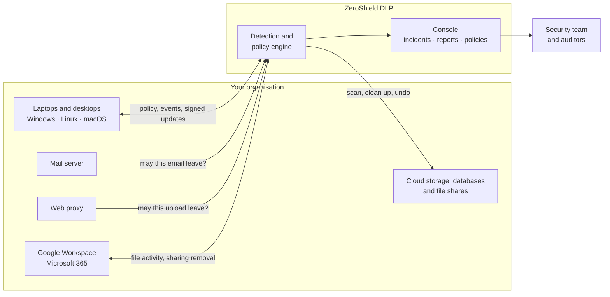

**Detection pipeline: from content to decision**

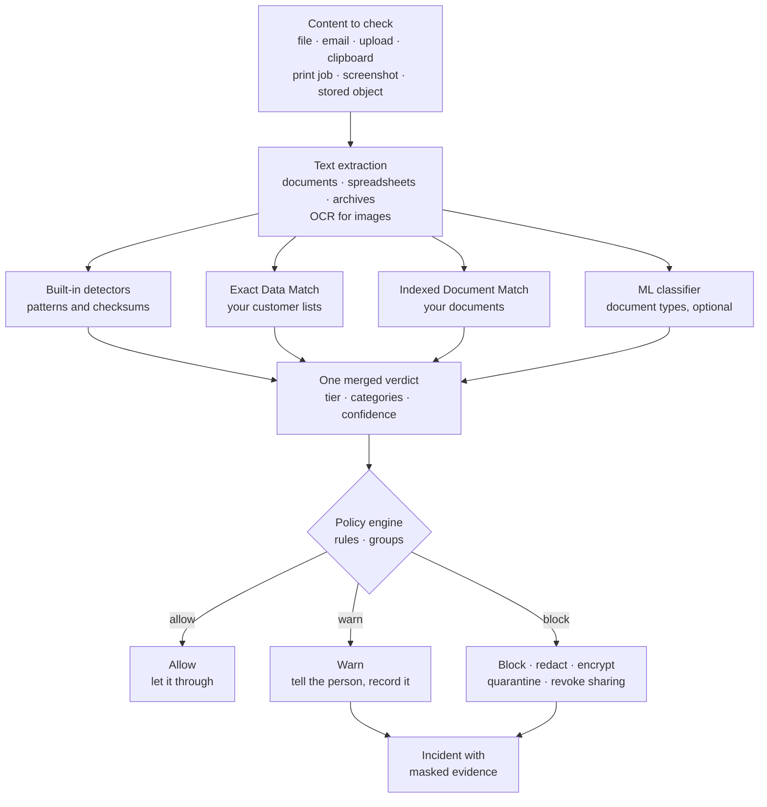

---

## Core Modules

Everything is managed from one console: the Data Protection screens for day-to-day work, and the Settings screens for people, groups, roles and retention.

### 1. Detection Engine
Every channel hands content to the same engine, which returns one verdict: a sensitivity tier, the categories found and a masked sample.
* 🆔 **Indian identifiers built in**: Aadhaar (Verhoeff checksum), PAN, GSTIN, IFSC codes, UPI IDs, and Indian passport and mobile numbers.
* 💳 **Cards and secrets**: payment cards (Luhn checksum), and API keys, private keys and tokens from AWS, GitHub, Slack, Google, Stripe, OpenAI and Anthropic.
* 🧬 **Your own data**: upload customer lists (Exact Data Match) and confidential documents (Indexed Document Match) to catch those exact records and passages.
* 🧩 **Custom detectors and keywords**: add your own formats, such as employee IDs, or words such as project code names, and test them before saving.
* 📄 **Beyond plain text**: PDFs, Office files, spreadsheets and archives are opened, and text in images is read with OCR.

  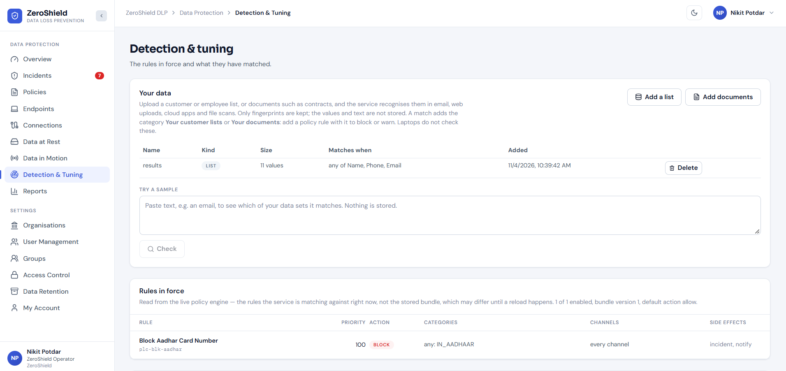
   
  <em>Detection & Tuning: your customer lists and documents, the rules in force and what has matched</em>

### 2. Policies & Enforcement
A policy says what to look for, where, for whom, and what to do when it is found.
* 🎚️ **Monitor, Warn or Block**: one switch sets how strictly every rule is enforced, so you can watch first and enforce when ready.
* ⛔ **Actions to fit the channel**: allow, warn, block, redact, encrypt, quarantine, tombstone or revoke sharing.
* 🙋 **Continue with a reason**: on Windows, people can continue past a block by giving a reason, which appears on the incident for review.
* 💾 **USB device control**: on Windows and Linux, limit USB storage to company-approved drives.
* 🚫 **Blocked destinations**: list the sites and addresses laptops may not connect to, such as file-sharing sites.

  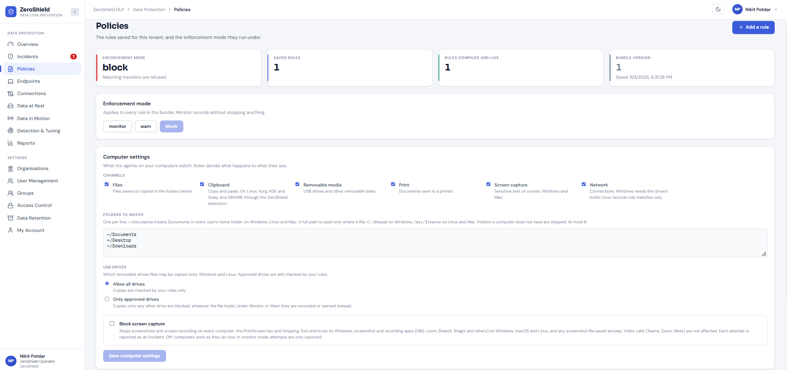
   
  <em>Policies: enforcement mode, computer settings and the rules in force</em>

  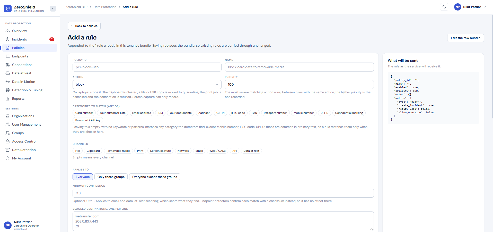
  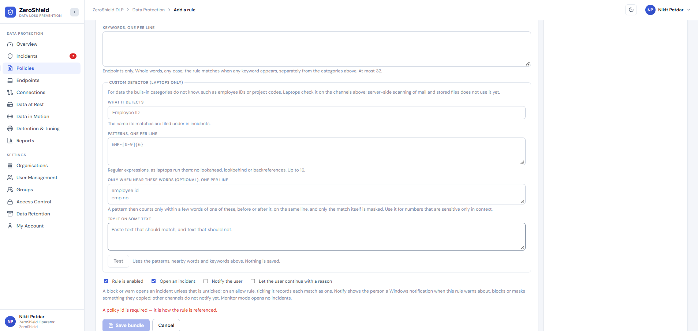
   
  <em>Rule editor: what to look for, on which channels, for whom, and a live test for custom detectors</em>

### 3. Groups
Groups collect people and computers, such as *Finance*, *Contractors* or *Branch Operations*, so each rule reaches exactly the teams it is meant for.
* 👥 **People and computers together**: add enrolled computers, and add people by their sign-in name or email address.
* 🎯 **Applies to**: any rule can apply to everyone, only to chosen groups, or to everyone except them.
* 🌐 **Every channel**: groups work on laptops and in email, cloud apps and web uploads.
* 🔎 **Clear at a glance**: each group shows its computers, its people and the rules that use it.

**Example:** block card numbers on USB drives for *everyone except Treasury*, and give Treasury its own rule that only warns.

  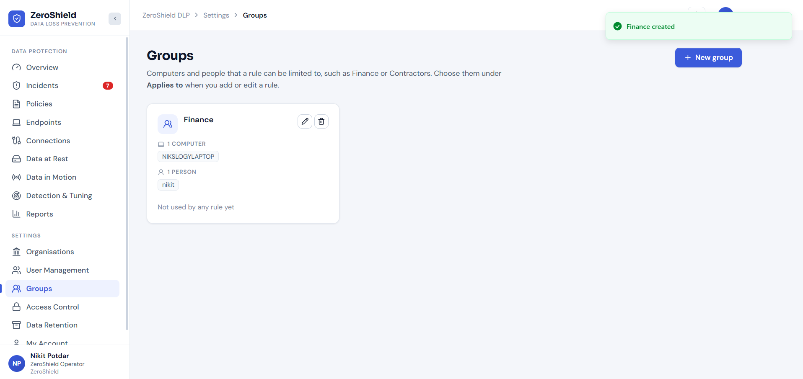
   
  <em>Groups: each group's computers, people and the rules that use it</em>

### 4. Endpoint DLP
A lightweight agent checks activity on each computer against your policy and enforces it on the device, online or offline.

| Channel | What the agent does |
| :--- | :--- |
| 📁 **Files** | Checks files saved, copied or renamed in watched folders, and blocks or quarantines sensitive ones |
| 📋 **Clipboard** | Checks every copy and clears sensitive ones |
| 💾 **USB drives** | Quarantines sensitive files copied to removable drives |
| 🖨️ **Print** | Cancels print jobs that carry sensitive data |
| 🖥️ **Screen** | Records sensitive data shown on screen, and stops screenshots and recordings when Block screen capture is on |
| 🌐 **Network** | Refuses connections to blocked sites, whichever browser or tool is used |

**Block screen capture** switches off the PrintScreen and Snipping Tool keys on Windows, closes screenshot and recording apps such as OBS, Loom, ShareX and Snagit as they start, and removes any capture saved anyway. Teams, Zoom and Meet calls keep working, and each attempt is recorded as an incident.

### 5. Data in Motion
Data being sent is checked against the same policies, whichever route it takes.
* 📧 **Email**: your mail server checks each outgoing message with ZeroShield before it leaves, and can deliver, warn, redact, encrypt, hold or reject it. Sent Gmail and Outlook messages are also checked through Google Workspace and Microsoft 365.
* ☁️ **Cloud apps**: files uploaded to or shared from Google Drive and OneDrive are checked, and outside sharing on sensitive files is removed. The owner keeps the file.
* 🌐 **Web uploads**: your web proxy (Squid, Zscaler, Palo Alto, Fortinet and others) asks ZeroShield over ICAP before an upload leaves, and a blocked upload shows the person a ZeroShield page.
* 📂 **File transfer**: FTP and SFTP uploads are allowed or refused in the same way.

  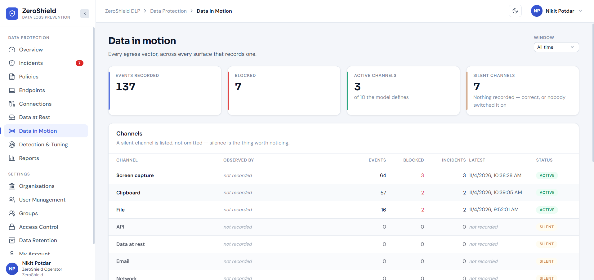
   
  <em>Data in Motion: activity per channel and every email decision</em>

### 6. Data at Rest
Find sensitive data sitting in storage, see exactly where it is, and clean it up.
* 🗄️ **Where**: Amazon S3, Azure Blob Storage, Google Cloud Storage, PostgreSQL, MySQL, SQL Server, Oracle and Windows file shares, with nothing to install on them.
* 🔁 **Scans**: run now or on a schedule. Repeat scans skip anything that has not changed.
* 🔎 **Findings**: which file, object or column holds what, with a masked sample. Database scans sample columns and store no rows.
* 🧹 **Clean-up with undo**: quarantine, tombstone, revoke access or encrypt findings in Amazon S3, and undo any of them in one click.
* 🔑 **No keys shared for S3**: access is a read-only role in your own AWS account.

  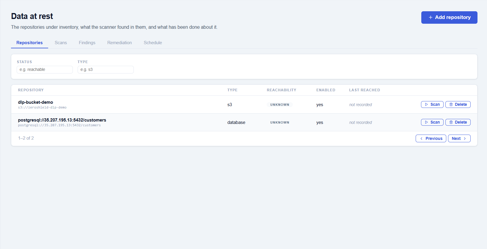
   
  <em>Data at Rest: what was found and where, with a masked sample</em>

### 7. Incidents & Investigation
Every block, warning and recorded match becomes an incident that answers an investigator's first questions.
* 👤 **Who and where**: the person or sender, and the computer, file or storage location.
* 🔎 **What**: the sensitivity tier, the categories and a masked sample such as `**** **** **** 1111`. The real value is never stored.
* 📜 **Why**: the rule that matched, the action taken and, if someone continued past a block, the reason they gave.
* 🧭 **Workflow**: Open → Investigating or Escalated → Resolved, with notes and a timeline. Repeated events are grouped into one incident.
* 🔔 **Live**: new incidents appear as they happen, with a notice on whichever page you are on.

  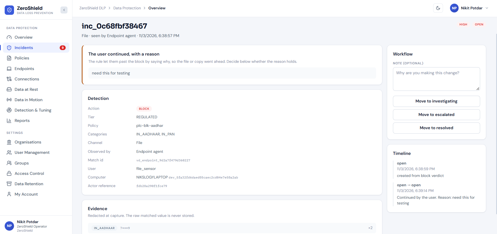
   
  <em>Incident detail: who, where, what was found, the rule and the action taken</em>

### 8. Connections
One screen shows every route data can take, whether it is protected, and how to set it up.
* 🗺️ **Every route**: laptops and desktops, stored data, email, cloud apps and the company network.
* 🚦 **Live state**: each route shows whether it is connected and able to block.
* 🧭 **Guided setup**: the steps for each route, from downloading the agent installer to approving ZeroShield in Google Workspace or Microsoft 365, with no password shared.

  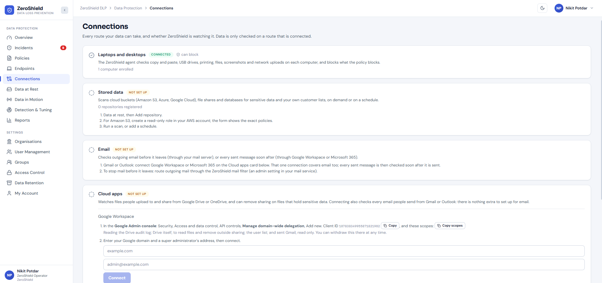
   
  <em>Connections: every route data can take, and whether it is protected</em>

### 9. Dashboards & Reports
Show management what is protected and what was stopped, and give auditors the evidence they need.
* 🏠 **Overview**: open incidents, agents online, sensitive findings, the 30-day trend and activity per channel.
* 📈 **Channel coverage**: what each channel checked and blocked, and its health.
* 🩺 **Detector health**: which detectors are switched on and able to match.
* 📚 **Compliance reports** for the DPDP Act 2023, PCI DSS v4.0, GDPR and the HIPAA Security Rule: the data each law protects, how far your policy covers it, the incidents, and any data that got through. Reports carry no samples of the data and can be printed to PDF.
* ⚡ **Live console**: screens refresh on their own, with light and dark themes.

  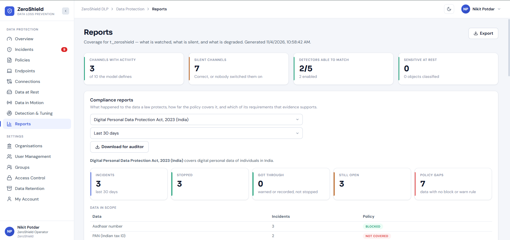
   
  <em>Reports: channel coverage, detector health and compliance</em>

### 10. Data Retention & Export
Decide how long endpoint activity is kept, and take a copy whenever you need one.
* ⏳ **Your retention period**: keep endpoint activity for 30, 90 or 180 days, 1 or 2 years, or forever.
* 🧹 **Automatic clean-up**: older activity is deleted on its own.
* 🛡️ **Evidence kept**: incidents, and the activity behind them, are kept whatever period you choose.
* 📥 **Export to CSV**: download activity filtered by date, channel and outcome, ready for Excel or Google Sheets.

### 11. Users, Roles & Access Control
Each organisation has its own people, roles and data.
* 🏢 **Sign-up and approval**: an organisation signs up from the sign-in page, and its first administrator is set up once ZeroShield approves the request.
* 👤 **User management**: add people, change roles, reset passwords and disable accounts, with a log of sign-ins and account changes.
* 🗝️ **Access control**: see exactly what each role may do. The server enforces it on every request.

| Role | What they can do |
| :--- | :--- |
| **Administrator** | Everything, including policies, groups, retention, computers and users |
| **Security Analyst** | Triage incidents, run scans, clean up findings and export activity |
| **Auditor** | Read every screen and export activity, without changing anything |
| **Employee** | Sign in and see their own account |

  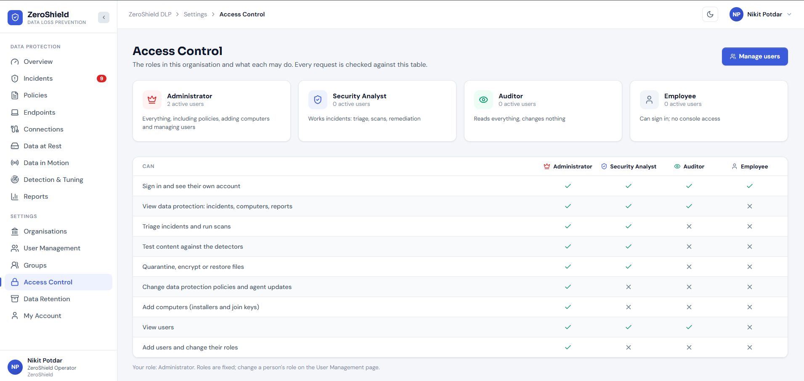
   
  <em>Access Control: what each role may do, and how many people hold it</em>

---

## Endpoint Agent & Deployment

The agent is installed on each computer from the console, and looks after itself from then on.

| | **Windows** | **Linux** | **macOS** |
| :--- | :--- | :--- | :--- |
| **Versions** | Windows 11 and Windows Server 2022, 64-bit | Debian 12+, Ubuntu 22.04+, RHEL, Rocky and AlmaLinux 9+, Amazon Linux 2023, 64-bit | macOS 14 Sonoma or later |
| **Installer** | MSI | .deb and .rpm | .pkg |

* 📥 **Simple install**: download a one-file installer from the console, which installs the agent and enrols the computer. A silent install is available for software-distribution tools.
* ✍️ **Signed automatic updates**: roll out to pilot devices first, then to everyone. The agent installs only releases signed by ZeroShield, and goes back to the previous version on its own if a new one fails to start.
* 🛡️ **Tamper-resistant and self-healing**: a standard user cannot stop or change the agent, and any part that stops is restarted and reported to the console.
* 📴 **Works offline**: the agent keeps enforcing its cached policy and uploads events when the network returns.

---

## Security & Privacy

* 🎭 **Masked at capture**: incidents and findings keep a masked sample and the category, never the matched value.
* 🧬 **Fingerprints, not copies**: customer lists and documents are stored only as fingerprints, and database scans store no rows.
* 🏢 **Tenant isolation**: the server keeps each organisation's data apart. It takes the organisation from the signed-in session, never from the browser.
* 👥 **Role-based access**, checked by the server on every request.
* 🔑 **No passwords shared for cloud**: Amazon S3 uses a read-only role in your AWS account, and Google Workspace and Microsoft 365 use an admin approval you can withdraw at any time. Other credentials are encrypted at rest.
* 📝 **Audit trail**: sign-ins, account changes, policy changes and incident updates are recorded.
* 🕶️ **Pseudonymous mode**: optionally, investigators see a stable pseudonym instead of the employee's name.

---

## Governance & Compliance

| Framework | How ZeroShield DLP supports it |
| :--- | :--- |
| 📜 **DPDP Act 2023 (India)** | Detects Aadhaar, PAN, passport, mobile, UPI, IFSC and card data, controls how it leaves, and has a dedicated report |
| 🏦 **RBI guidelines** | Leak prevention for customer and account data on every channel, with an auditable incident trail |
| 💳 **PCI DSS v4.0** | Luhn-validated card detection on every channel, discovery of stored card data, and a dedicated report |
| 🔏 **GDPR** | Personal-data detection, a record of data that got through to support the 72-hour breach decision, and a dedicated report |
| 🏥 **HIPAA Security Rule** | Detects the identifiers that make health information PHI, custom detectors for medical record numbers, and a dedicated report |
| 📋 **ISO 27001:2022 and SOC 2** | Data leakage prevention (ISO 27001:2022 control 8.12) on every channel, with the incident history, coverage reports and audit log as evidence |

---

## Target Users & Example Scenarios

ZeroShield DLP is built for organisations that hold regulated personal or financial data, or intellectual property they cannot afford to lose. The scenarios below are illustrative.

### Banking & Financial Services
Protect customer, account and card data across branches, back offices and cloud storage.

**Example scenario:** Ananya, CISO of a private bank, starts in Monitor mode and loads the customer master as an Exact Data Match list, so ZeroShield recognises the bank's real customers. After a week she moves to Block: card numbers copied to the clipboard are cleared, print jobs carrying PANs are cancelled, and exports copied to USB drives are quarantined for everyone except Treasury, whose own rule only warns. For the audit committee she shares the DPDP compliance report.

### Fintech & Payments
Keep card data inside the cardholder data environment, and keep secrets out of email and uploads.

**Example scenario:** Rohan leads security at a payments company. A database scan, which copies no rows, finds card numbers in a support-ticket table that should never have held them. On developer laptops, copied AWS and Stripe keys are cleared from the clipboard, and the web proxy refuses uploads of card data to paste sites. The PCI DSS v4.0 report shows auditors the rules that protect card data and every incident in the period.

### Contact Centres & BPO
Protect the customer data agents see on screen all day.

**Example scenario:** Meera runs security for a contact centre that handles card and Aadhaar details. She turns on Block screen capture, so agents cannot take screenshots or record customer screens, while Teams and Zoom calls carry on. Her clients ask for a year of activity records, so she sets retention to one year and exports a CSV each quarter.

### Healthcare
Protect patient identifiers and clinical documents shared by email and cloud drives.

**Example scenario:** Kavita adds a custom detector for her hospital group's medical record numbers and loads the patient register as an Exact Data Match list. When a discharge summary is shared on Google Drive with a public link, the outside sharing is removed within minutes. Investigators see only masked samples and, in pseudonymous mode, a pseudonym instead of the employee's name.

### IT Services & SaaS
Protect client contracts, design documents and credentials across a distributed workforce.

**Example scenario:** Arjun indexes client contracts and design documents with Indexed Document Match, so an excerpt pasted into an outgoing email or web upload is caught. API keys and private keys are caught on laptops and in outgoing mail. For ISO 27001 and SOC 2 audits, the incident history and coverage report show where client data is checked.

### Manufacturing & Engineering
Protect drawings, price lists and supplier data.

**Example scenario:** Sanjay indexes design documents and supplier price lists with Indexed Document Match, and adds project code names as keywords. USB storage is limited to company-approved drives, so a file copied to a personal stick is quarantined on the stick. Weekly scans of the company's Amazon S3 buckets find stray copies of price lists, which are tombstoned with a note saying where each file went.

---

## Use Cases

* 📜 **DPDP readiness**: find where personal data lives, control how it leaves, and report on it.
* 💳 **PCI DSS scope control**: find stored card numbers and stop card data leaving through any channel.
* 🚪 **Insider risk and departing employees**: watch USB drives, printing, the clipboard, uploads and email for exports of customer data.
* 🖼️ **Screen capture control**: stop screenshots and recordings where screens show customer, patient or payment data.
* 🎯 **Contractors and third parties**: give contractors and vendors stricter rules, using Groups.
* ☁️ **Cloud sharing hygiene**: remove public and external links on Drive and OneDrive files that hold sensitive data.
* 🔑 **Secret leakage**: catch API keys, tokens and private keys before they leave laptops, mail and uploads.
* 🗄️ **Data discovery and minimisation**: inventory sensitive data across cloud storage, databases and file shares.
* 🧾 **Audit preparation**: give auditors per-law compliance reports, coverage reports and the incident history.

---

## Support

* 📧 **Contact**: [vartul@zeroshield.ai](mailto:vartul@zeroshield.ai)
* 📧 **Support Queries**: [support@zeroshield.ai](mailto:support@zeroshield.ai)

---

> **Value Proposition:** ZeroShield DLP gives security teams one console and one set of policies to find sensitive data, stop it leaving through laptops, email, cloud apps and the network, clean up what is exposed in storage, and prove it to auditors, with each organisation's data kept private.

---

All rights reserved. This software and its documentation are the intellectual property of [ZeroShield](https://zeroshield.ai).